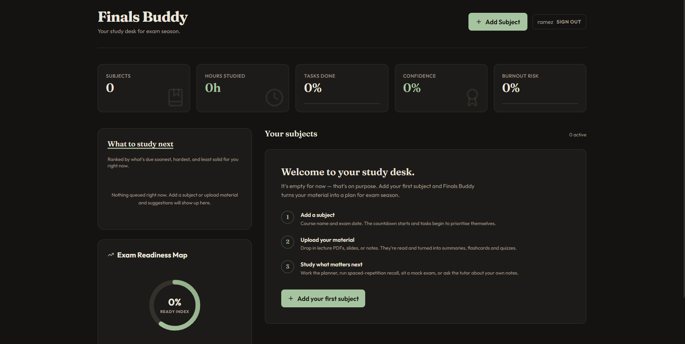
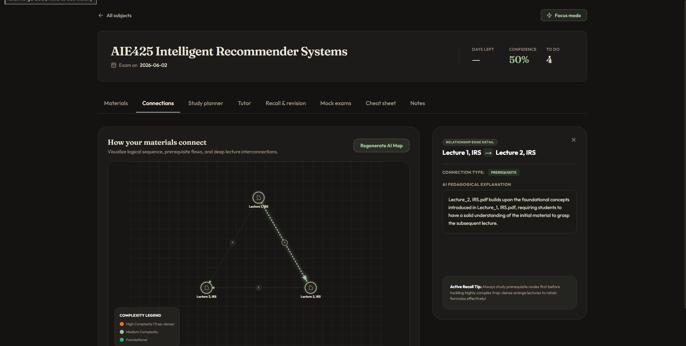
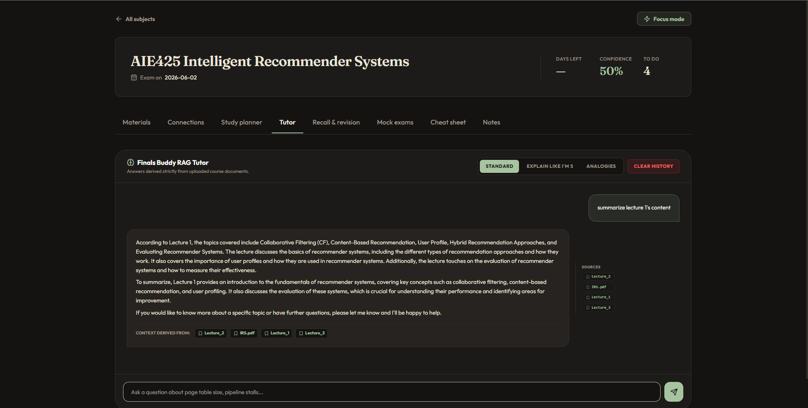
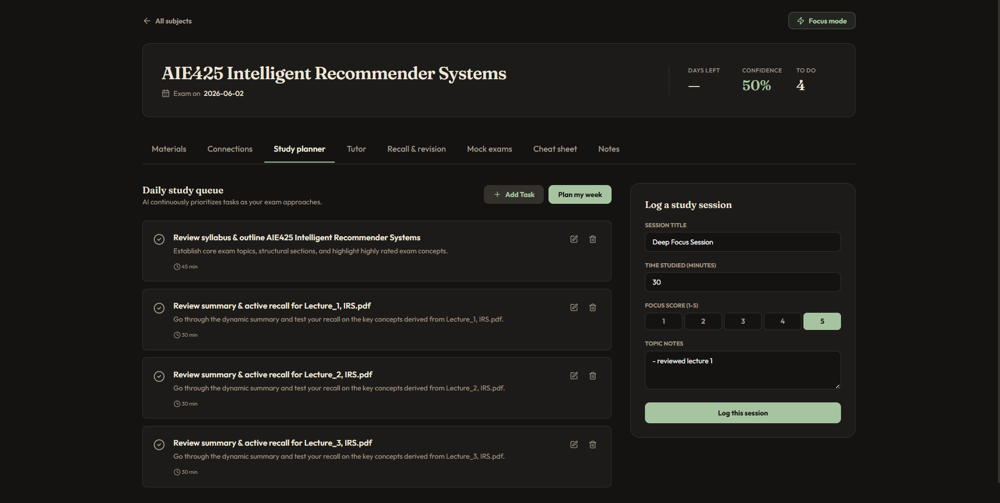

# Finals Buddy

**An AI-powered study companion that turns your lecture slides, PDFs, and notes into an adaptive finals-prep workspace: flashcards, quizzes, mock exams, a RAG tutor, and a smart study planner, all generated from your own course material.**

<p align="center">
  
  
  
  
  
  
  
  
</p>


<p align="center">
  <a href="https://finals-buddy.vercel.app"><b>🚀 Live Demo</b></a> &nbsp;·&nbsp;
  <a href="https://finalsbuddy.duckdns.org/docs"><b>📖 API Docs</b></a>
</p>


---

## What it does

Upload your course material and Finals Buddy does the rest, parsing the documents, mapping out the key topics, and building a full active-recall study system around them. Every study aid is grounded in **your** slides, not generic content.

| Feature | Description |
|---|---|
| **Material ingestion** | Upload `PDF`, `DOCX`, `PPTX`, or `TXT`. Files are parsed, chunked, embedded into a vector store, and turned into a structured **knowledge map** of topics and difficulty. |
| **Auto-generated flashcards** | Leitner-box **spaced repetition** (1 → 2 → 3 → 4 → 5-day intervals) built automatically from your material. |
| **Active-recall quizzes** | Multiple-choice quizzes generated per topic, with instant grading and explanations. |
| **Mock exams** | Full timed practice exams generated from your material, auto-graded on submission. |
| **RAG tutor** | Chat with your own material. Switch tutor personas: *Standard*, *Explain like I'm 5*, or *Analogies*: for the explanation style that clicks. |
| **Formula sheets** | Auto-extracted, KaTeX-rendered formula reference sheets with per-formula notes. |
| **Rich notes** | A Notion-style block editor (TipTap) with Markdown, math, images, and file embeds. |
| **Smart study planner** | Task checklist whose priorities re-rank themselves as exam dates approach. |
| **Recommendation engine** | Surfaces the single highest-ROI thing to do next via a weighted priority score (see below). |
| **Focus mode** | Distraction-free full-screen canvas with a built-in Pomodoro timer. |
| **Auth + admin** | JWT authentication and a lightweight admin dashboard (usage stats, logs, health checks, live API-key rotation). |
| **Free trial + BYOK** | Every visitor gets a handful of free AI generations, then brings their own (free) Groq API key for unlimited use, so hosting costs stay flat no matter how many people try it. |

### Free trial & bring-your-own-key

Finals Buddy is a hosted demo, so AI usage is metered. New accounts get **5 free AI actions** on the shared key; after that, a prompt in **Account settings** asks for a personal [Groq API key](https://console.groq.com/keys) (free to create). Once added, all AI requests run on the user's own account with no cap. Personal keys are **encrypted at rest**, validated before saving, and never displayed in full again.

### The recommendation score

The dashboard ranks every pending task with a weighted priority formula:

```
Score = (Exam Urgency × 0.4) + (Topic Importance × 0.3) + ((100 − Confidence) × 0.2) + (Incompletion × 0.1)
```

So the thing you're least confident about, on the subject with the nearest exam, always floats to the top.

---

## Screenshots


#### Dashboards

#### Subject Portal

#### RAG Tutorr Agent

#### Tasks Planner


---

## Tech Stack

**Frontend**
- **Next.js 16** (App Router, Turbopack) + **React 19** + **TypeScript**
- **Tailwind CSS v4**: fully responsive, mobile-first
- **TipTap** rich-text editor · **KaTeX** math rendering · **lucide-react** icons

**Backend**
- **FastAPI** + **SQLAlchemy 2** + **SQLite** + **Pydantic v2**
- **LangChain** + **LangGraph** agent orchestration over **Groq**, model set by `GROQ_MODEL`
- Document parsing via **pypdf**, **docx2txt**, **python-pptx**
- A lightweight NumPy vector store for RAG retrieval
- **JWT** auth
- **Prometheus metrics** on the RAG and LLM layer, not just the server

**Infrastructure**
- **Kubernetes (k3s)** on **AWS EC2**, with **Caddy** for automatic HTTPS
- **Terraform** for the whole environment: EC2, ECR, IAM, encrypted secrets in SSM Parameter Store
- **Prometheus + Grafana** in-cluster, dashboard provisioned from the repo
- **Frontend on Vercel**
- **GitHub Actions CI/CD**: tests and a retrieval-quality gate, then build, push to ECR and deploy over **AWS Systems Manager**. Authentication is **OIDC**, so no AWS credentials are stored in GitHub, and there is no SSH key or open port 22

---

## Getting Started

**Requirements:** Node.js 18+ and Python 3.11+.
AI features need a free [Groq API key](https://console.groq.com/keys). Without one, CRUD/auth still work fully and AI-generation endpoints return a clear `503` (no fake data).

### 1. Backend

```bash
cd backend
python -m venv venv
# Windows: .\venv\Scripts\Activate.ps1   |   macOS/Linux: source venv/bin/activate
pip install -r requirements.txt

cp .env.example .env        # then add your GROQ_API_KEY
python -m uvicorn app.main:app --reload --port 8000
```

API + interactive Swagger docs → **http://localhost:8000/docs**

### 2. Frontend

```bash
cd frontend
npm install
npm run dev
```

App → **http://localhost:3000**

> If the frontend and backend run on different hosts, set `NEXT_PUBLIC_API_URL` for the frontend (e.g. `http://localhost:8000/api`).

---

## Project Structure

```
finals-buddy/
├── backend/                      # FastAPI + SQLAlchemy + SQLite
│   ├── app/
│   │   ├── main.py               # API endpoints (auth, subjects, materials, quizzes, …)
│   │   ├── admin.py              # Admin dashboard API (stats, logs, key rotation)
│   │   ├── auth.py               # JWT authentication
│   │   ├── config.py             # Env config + runtime key overrides
│   │   ├── models.py             # SQLAlchemy tables
│   │   ├── schemas.py            # Pydantic schemas
│   │   └── services/
│   │       ├── langchain_chat.py # LangChain/LangGraph tutor + generation
│   │       ├── agents.py         # Agent orchestration
│   │       └── vector_store.py   # RAG embeddings + retrieval
│   └── Dockerfile
├── frontend/                     # Next.js 16 App Router
│   └── src/
│       ├── app/
│       │   ├── page.tsx          # Global dashboard
│       │   ├── subject/[id]/     # Interactive subject portal (notes, quizzes, tutor…)
│       │   ├── admin/            # Admin dashboard UI
│       │   └── login/
│       ├── components/           # NotionEditor, Toast, …
│       └── lib/api.ts            # API client
├── infra/
│   ├── terraform/                # EC2 + k3s, ECR, IAM (OIDC), SSM secrets
│   ├── k8s/                      # app, Caddy, Prometheus, Grafana manifests
│   └── scripts/                  # manifest apply, secret sync, demo seed
├── .github/workflows/            # CI/CD: test → quality gate → build → deploy
└── README.md
```

---

## Deployment

Live at **[finals-buddy.vercel.app](https://finals-buddy.vercel.app)**, with the backend on **AWS**.

The backend runs as four workloads on a single-node **k3s** cluster: the API, **Caddy** for automatic HTTPS, **Prometheus**, and **Grafana**. The database, uploads and vector store live on a persistent volume. The entire environment is defined in **Terraform** under `infra/`, and application secrets live encrypted in **SSM Parameter Store** — Terraform creates the parameters but is deliberately blind to their values, so no key reaches git or state.

Deploys run through **GitHub Actions**: tests and a retrieval-quality gate must pass, then the image is built, pushed to **ECR**, and rolled out over **AWS Systems Manager**. GitHub authenticates by **OIDC**, so no AWS credentials are stored in the repository, and the instance has no SSH key and no open port 22. Every deploy is smoke-tested against `/health` and `/metrics` before the run goes green.

Full technical detail, including what the monitoring caught in its first hour, is in [`docs/DOCUMENTATION.md`](docs/DOCUMENTATION.md).

---

## License

Released under the MIT License.

---

<p align="center"><i>Built to make finals week a little less painful.</i></p>
